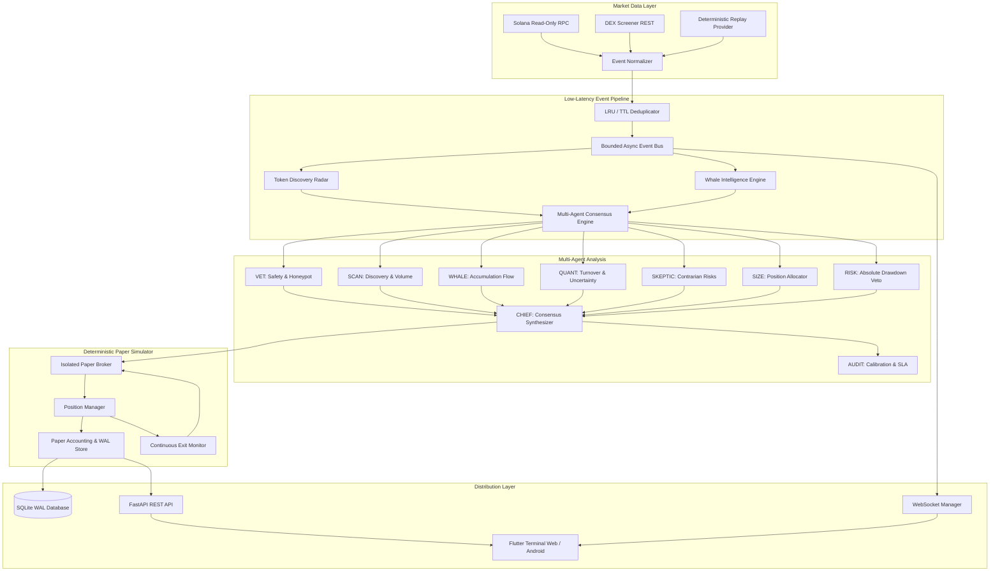

# System Architecture — SOLANA PREDATOR

## 1. Architectural Overview

SOLANA PREDATOR is architected as an asynchronous, event-driven intelligence terminal decoupled into an autonomous backend processing daemon and a reactive frontend client.

---

## 2. Component Design Principles

### Decoupled Background Execution
The backend runs as a standalone Python 3.12+ `uvicorn` service. It does not depend on the Flutter frontend remaining connected or active. All persistent state resides in SQLite configured with Write-Ahead Logging (`WAL`), supporting atomic commits and instant crash recovery.

### Inviolable Risk Boundary
The `RISK` agent possesses unilateral veto power:
- If portfolio drawdown exceeds 15%, all new simulated buying is vetoed.
- If concurrent open positions reach the configured limit (default: 5), new candidates are vetoed.
- If the token is already actively held, duplicate allocations are vetoed.
- `CHIEF` cannot override a `RISK` veto under any circumstances.

### Strict Read-Only Security Model
The system does not import, store, or accept Solana private keys, seeds, or signers. The paper broker is completely separated from the on-chain networking adapters, eliminating any possibility of accidental mainnet funds transmission.
