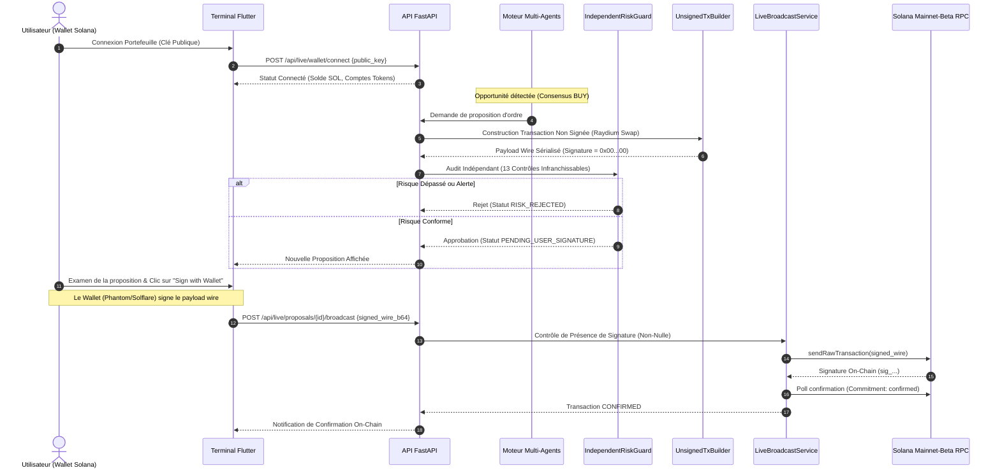

# SOLANA PREDATOR — Architecture du Live Trading

## 1. Principes Directeurs et Frontières de Sécurité

Le module Live Trading de **SOLANA PREDATOR** fournit une intégration d'exécution réelle sur la blockchain Solana selon le paradigme **zéro-détention de clés privées** (*non-custodial execution*).

### Règle d'Or de Sécurité :
- **Le backend ne détient, ne manipule et ne requiert JAMAIS de clés privées, seed phrases ou permissions de signature autonome.**
- Les agents autonomes peuvent identifier des opportunités et formaliser des propositions de swap, mais **ne peuvent en aucun cas signer ou exécuter une transaction financière réelle**.
- **Toute transaction réelle requiert la signature cryptographique explicite de l'utilisateur dans son portefeuille matériel ou logiciel.**

---

## 2. Diagramme de Séquence de l'Exécution

---

## 3. Séparation Stricte Paper Trading vs Live Trading

| Propriété | Paper Trading Simulator | Live Trading Module |
|---|---|---|
| **Capital & Fonds** | 100% Virtuel (Grand livre double-entrée simulé) | Réel (Portefeuille Solana de l'utilisateur) |
| **Génération d'Ordres** | Automatique par le `PaperBroker` | Proposition passive soumise à approbation |
| **Signature** | Aucune signature requise | **Obligatoire par clé privée de l'utilisateur** |
| **Diffusion Réseau** | Aucune interaction réseau d'écriture | Diffusion RPC Solana (`sendRawTransaction`) |
| **Tables SQLite** | `paper_orders`, `paper_fills`, `paper_positions` | `live_proposals`, `live_transactions`, `risk_audit_log` |
| **Avertissement UI** | `PAPER TRADING ONLY` (Bandeau vert) | `LIVE TRADING — EXPLICIT USER SIGNING REQUIRED` (Bandeau ambre) |

---

## 4. Format des Transactions Non Signées

Le module `UnsignedTransactionBuilder` génère des transactions Solana Versioned conformes au format wire natif :
1. **En-tête de message** : `num_required_signatures = 1`, `num_readonly_signed_accounts = 0`, `num_readonly_unsigned_accounts = 1`.
2. **Emplacement de signature** : Exactement 64 octets de zéros (`0x00...00`), garantissant que la transaction est impossible à diffuser telle quelle.
3. **Comptes impliqués** : Clé publique de l'utilisateur (payeur de frais), mint du token cible, programmes autorisés (Raydium, System Program, Token Program).
4. **Instructions inspectées** : Swap d'entrée (SOL) vers sortie minimale garantie ($MinTokens_{out}$ calculé d'après le slippage toléré).
