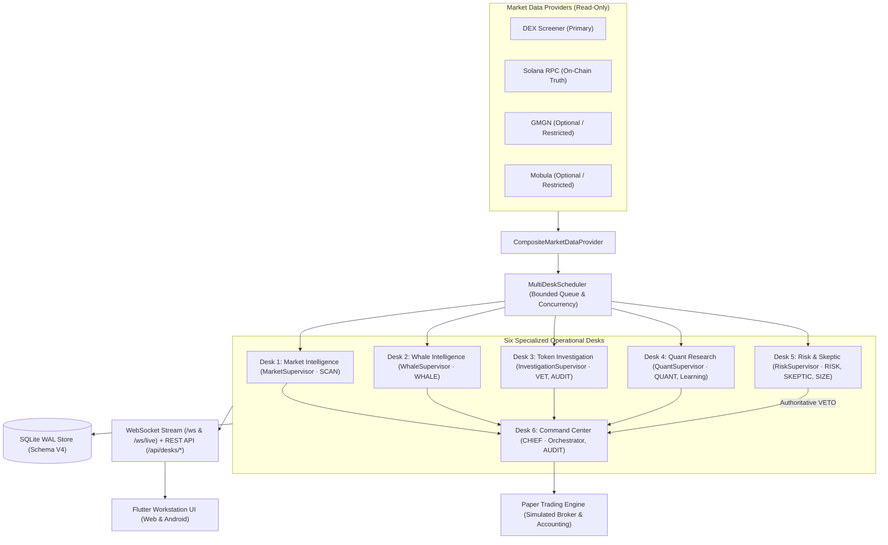

# SOLANA PREDATOR — Multi-Desk Architecture Specification

## 1. Repository Audit & Actual Starting State

- **Repository**: `https://github.com/frechfanta-os/solana_predator`
- **Local Directory**: `/root/solana_predator`
- **Branch**: `main`
- **Starting Commit**: `e186beaa7b4deb99cb4c16b7825265aa217196b4` (`e186bea`)
- **Working Tree Status**: Clean (`git status --short` empty)
- **Protected Repositories**:
  - `/root/aidesk`: Clean and untouched
  - `/root/gmgn_sentinel_desk`: Clean and untouched
- **Baseline Test Suite**:
  - Backend: **111 / 111 passed** (`pytest backend/tests/ -v`)
  - Frontend Static Analysis: **0 issues** (`flutter analyze`)
  - Frontend Widget Tests: **5 / 5 passed** (`flutter test`)
- **Existing SQLite Schema**: `CURRENT_SCHEMA_VERSION = 3` (`SCHEMA_V1`, `SCHEMA_V2`, `SCHEMA_V3`) with Write-Ahead Logging (`WAL`) enabled.

---

## 2. Before / After Architecture Map

### Before (`e186bea`)
- **Backend**: Single monolithic event pipeline (`PredatorEngine.process_market_event`) running all 9 agents synchronously on every incoming market event, broadcasting a single `PIPELINE_UPDATE` WebSocket message on `/ws`.
- **Persistence**: Schema V1–V3 storing `market_events`, `token_registry`, `whale_activities`, `agent_decisions`, `chief_decisions`, `decision_outcomes`, `paper_*`, `live_*`, and `system_config`. No dedicated desk state, task lifecycle tracking, structured evidence-vs-inference agent reports, or desk-level pause/resume controls.
- **Frontend**: 12 flat navigation tabs (`Market`, `Radar`, `Whales`, `Agents`, `Learning`, `Live Trade`, `Portfolio`, `Positions`, `Exits`, `Events`, `Health`, `Config`) without unified multi-desk supervision, task queues, structured desk reports, or central Command Center aggregation.

### After (Multi-Desk Intelligence Workstation)
- **Backend Multi-Desk Coordinator & Asynchronous Scheduler (`backend/desks/`)**:
  - Organizes existing agents and subsystems into **Six Operational Desks**, each managed by a named Supervisor, backed by real existing agent instances (`SCAN`, `WHALE`, `VET`, `QUANT`, `SKEPTIC`, `SIZE`, `RISK`, `CHIEF`, `AUDIT`), bounded task queues, configurable polling/scheduling intervals, per-provider request budgets, deduplication, and pause/resume controls.
  - Persists desk metadata, task executions (`IDLE`, `QUEUED`, `RUNNING`, `COMPLETED`, `FAILED`, `SKIPPED`, `PAUSED`), structured reports (explicitly separating *observed facts*, *inferred conclusions*, and *missing/unknown fields*), watchlist items, and provider/system health transitions in **SQLite Schema V4** (`SCHEMA_V4`).
  - Extends `/ws` and mounts `/ws/live` with backward-compatible `PIPELINE_UPDATE` plus 12 structured event types (`system.health`, `desk.status`, `agent.status`, `agent.task.started`, `agent.task.completed`, `agent.task.failed`, `agent.report.created`, `market.observation`, `provider.health`, `risk.event`, `chief.summary`, `paper.position.updated`).
- **Frontend Professional Workstation (`frontend/lib/`)**:
  - 10 primary workstation destinations (`Command Center`, `Market Intelligence`, `Whale Intelligence`, `Token Investigation`, `Quant Research`, `Risk & Skeptic`, `Paper Portfolio`, `Agent Activity`, `Data Sources`, `Settings`) while preserving access to existing views (`Live Trading Dry-Run`, `Positions`, `Exit Monitor`).
  - Dense dark workstation aesthetic (`#0D1117` / `#161B22` / `#21262D`) with top telemetry bar, collapsible/responsive side panels, bottom execution log, and full support for loading, empty, live, stale, partial, unavailable, and reconnecting states.

---

## 3. Six Specialized Desks & Agent Responsibility Matrix

| Desk ID | Desk Name | Supervisor | Integrated Real Agents & Components | Core Responsibilities | Key Outputs & Invariants |
|---|---|---|---|---|---|
| `DESK_MARKET` | **Market Intelligence** | `MarketSupervisor` | `SCAN` (`ScanAgent`), `TokenRadar`, `CompositeMarketDataProvider` | Pair discovery via active providers, price/volume/liquidity monitoring, token watchlist management, staleness (>30s) and missing field detection. | Publishes `market.observation` and structured market reports. Never represents missing data as `0` or fabricates prices. |
| `DESK_WHALE` | **Whale Intelligence** | `WhaleSupervisor` | `WHALE` (`WhaleAgent`), `WhaleIntelligenceEngine` | Tracks public wallet addresses, classifies on-chain flows (`ACCUMULATION`, `DISTRIBUTION`, `SWAP_INFLOW`, `SWAP_OUTFLOW`, `SPL_TRANSFER_ONLY`, `FAILED`), detects multi-wallet convergence. | Distinguishes observed on-chain transactions from inferred convergence. Never invents wallet labels or holdings. |
| `DESK_INVESTIGATION` | **Token Investigation** | `InvestigationSupervisor` | `VET` (`VetAgent`), `AUDIT` (`AuditAgent`), `TokenRadar` | Validates base58 mint format, inspects pool/contract metadata (mint/freeze authority, liquidity depth), compares provider provenance, flags incomplete/contradictory data. | Evidence-backed risk warnings with source timestamps; never claims a token is guaranteed safe. |
| `DESK_QUANT` | **Quant Research** | `QuantSupervisor` | `QUANT` (`QuantAgent`), `DecisionOutcomeEvaluator`, `StrategyOptimizer` | Computes turnover/momentum indicators from real historical snapshots, validates dataset completeness, runs chronological `TRAIN`/`VALIDATION`/`TEST` backtests with fee/slippage assumptions. | Zero lookahead bias; never fabricates candles or presents backtests as proof of future profit. |
| `DESK_RISK` | **Risk & Skeptic** | `RiskSupervisor` | `RISK` (`RiskAgent`), `SKEPTIC` (`SkepticAgent`), `SIZE` (`SizeAgent`), `IndependentRiskGuard` | Challenges bullish assumptions, flags buy/sell anomalies, monitors simulated exposure/drawdown, enforces the authoritative **RISK VETO** and emergency simulation stop. | **CRITICAL INVARIANT**: `RISK` veto is authoritative on the backend and cannot be overridden by `CHIEF`, LLM, or UI. |
| `DESK_COMMAND` | **Command Center** | `CHIEF` | `CHIEF` (`ChiefAgent`), `AUDIT` (`AuditAgent`), `AgentOrchestrator`, `HealthTracker` | Aggregates reports from Desks 1–5, tracks agent/provider health, highlights inter-agent disagreements, synthesizes deterministic recommendation + `RISK` veto status. | Summarizes existing reports without fabricating evidence or overriding risk decisions. |

---

## 4. Data Flow Diagram

---

## 5. Agent Execution Contract & Structured Reports

### 5.1 Task & Agent States (`ExecutionState`)
- `IDLE`: Registered and ready; no active execution running.
- `QUEUED`: Task enqueued in bounded scheduler queue awaiting worker slot.
- `RUNNING`: Currently executing real agent/supervisor logic.
- `COMPLETED`: Finished within timeout and persisted result.
- `FAILED`: Raised an exception or timed out after bounded retries.
- `SKIPPED`: Skipped due to deduplication window, provider unavailability, or paused desk.
- `PAUSED`: Desk background analysis explicitly paused by operator.

### 5.2 Task Execution Record (`AgentTaskExecution`)
Every task execution persists and exposes:
- `task_id`, `event_id`, `desk_id`, `agent_id`
- `started_at`, `finished_at`, `duration_ms`, `status`
- `source`, `source_timestamp`, `observation_quality`
- `input_summary`, `output_summary`, `missing_fields`
- `error_code`, `error_message_sanitized`
- `confidence` (when supported by actual agent output)
- `prompt_version`, `model_id` (when LLM advisory is used)

### 5.3 Structured Agent Report (`StructuredAgentReport`)
Every desk report persists and exposes:
- `report_id`, `desk_id`, `supervisor`, `agent_id`, `token_mint`, `event_id`, `task_id`
- `observed_at`, `source_timestamp`, `created_at`, `source`, `observation_quality`
- `observed_facts`: List of directly measured metrics from verified payloads.
- `inferred_conclusions`: List of analytical deductions or heuristic classifications.
- `unknown_or_missing`: List of fields absent or unverifiable (`missing_fields`).
- `contradictions`: Disagreements between agents or providers.
- `risk_flags`: Evidence-backed warnings.
- `decision`, `confidence`, `rationale`, `is_stale`, `is_veto`

---

## 6. Database Migration Specification (`SCHEMA_V4`)

Added in `backend/database/schema.py` and applied automatically by `backend/database/migrations.py` (`CURRENT_SCHEMA_VERSION = 4`), preserving all existing V1–V3 tables and rows:
1. `desks`: Desk status, supervisor, pause state, polling interval, counters (`completed_count`, `failed_count`, `active_tasks`, `queued_tasks`), `last_run_at`, `last_duration_ms`, `last_error`.
2. `desk_tasks`: Full `AgentTaskExecution` history with idempotent `INSERT OR REPLACE` on `task_id` and indexes on `(desk_id, started_at DESC)` and `(agent_id, started_at DESC)`.
3. `desk_reports`: Full `StructuredAgentReport` records indexed by `(desk_id, created_at DESC)` and `(token_mint, created_at DESC)`.
4. `watchlist_items`: Operator watchlist for Market Intelligence (`item_type` = `TOKEN` or `WALLET`, `identifier`, `label`, `added_at`, `notes`).
5. `health_transitions`: Audit trail of provider and subsystem availability transitions.

---

## 7. REST & WebSocket Protocol

### 7.1 REST Endpoints (`/api/...`)
- `GET /api/desks`: List all 6 operational desks with live metrics, supervisor state, and counters.
- `GET /api/desks/{desk_id}`: Full desk workspace snapshot (status, agents, recent tasks, recent reports, watchlist/metrics).
- `GET /api/desks/{desk_id}/agents`: Real agent instances assigned to the desk and their execution metrics.
- `GET /api/desks/{desk_id}/tasks`: Paginated task execution history for the desk.
- `GET /api/desks/{desk_id}/reports`: Structured reports emitted by the desk.
- `POST /api/desks/{desk_id}/pause`: Pause background analysis for a desk (Admin Auth).
- `POST /api/desks/{desk_id}/resume`: Resume background analysis for a desk (Admin Auth).
- `POST /api/desks/{desk_id}/run`: Trigger an immediate on-demand execution cycle for a desk.
- `GET /api/watchlist` & `POST /api/watchlist` & `DELETE /api/watchlist/{identifier}`: Manage token & public-wallet watchlists.
- `GET /api/agents`: All 9 agents with current status (`IDLE`, `RUNNING`, etc.), desk assignment, latency, and call counts.
- `GET /api/agents/{agent_id}` & `GET /api/agents/{agent_id}/tasks`: Single agent detail and execution history.
- `GET /api/system/health`: Comprehensive observability snapshot (uptime, provider health, SQLite WAL status, active/queued/failed tasks, WebSocket client count, LLM status, Paper Trading status, execution mode, kill-switch state).

### 7.2 WebSocket Protocol (`/ws` and `/ws/live`)
Each structured event envelope includes:
- `event_id`, `event_type`, `timestamp_utc`, `desk_id`, `agent_id`, `correlation_id`, `payload_version` (`"1.0"`), and `payload`.
Supported `event_type` values:
- `system.health`, `desk.status`, `agent.status`, `agent.task.started`, `agent.task.completed`, `agent.task.failed`, `agent.report.created`, `market.observation`, `provider.health`, `risk.event`, `chief.summary`, `paper.position.updated` (plus backward-compatible `PIPELINE_UPDATE` and `PONG`).

---

## 8. Acceptance Criteria Checklist

1. Existing application starts and preserves all V1–V3 data and 111 existing backend tests.
2. All 6 desks are accessible via navigation and display real backend status, supervisor, tasks, reports, and provenance.
3. Real agents (`SCAN`, `WHALE`, `VET`, `QUANT`, `SKEPTIC`, `SIZE`, `RISK`, `CHIEF`, `AUDIT`) execute tasks persisted in SQLite V4.
4. `RISK` veto and persistent emergency kill-switch remain authoritative and non-bypassable.
5. Zero real transactions signed or broadcast; `ALLOW_TRANSACTION_SUBMISSION` remains `False`.
6. Protected repositories `/root/aidesk` and `/root/gmgn_sentinel_desk` remain 100% untouched.
